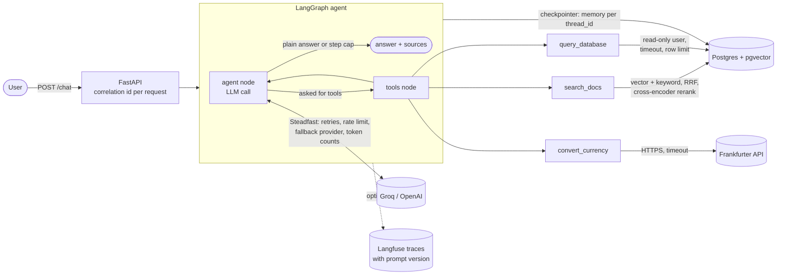

# Architecture

lookup-agent answers questions about a small online shop by looking things up first. It has three places to look:

| Source | What's in it | Tool |
|---|---|---|
| Policy documents | 9 Markdown files: returns, refunds, shipping, warranty... | `search_docs` |
| Postgres database | customers, products, orders, order items, support tickets | `query_database` |
| Live API | exchange rates (Frankfurter, European Central Bank rates) | `convert_currency` |

The model decides which tools to call, can call several in a row (for example: look up an order total, then convert it to CAD), and the answer comes back with a list of the sources it used.

## The big picture

## One request, step by step

1. **FastAPI** receives `POST /chat` (from the chat page at `/`, or from any other client) with a message and an optional `thread_id`. A middleware gives the request a correlation id (or keeps the caller's `X-Request-ID` when it looks like one) and binds it to every log line, including Steadfast's logs of each LLM call. A body over 64 KB is refused with 413 before it is read. Before the body is validated, the per-IP rate limit (`CHAT_RATE_LIMIT_PER_MINUTE`, 429 when over) and, if `CHAT_API_KEY` is set, the `X-API-Key` check (401) run, so a refused request never reaches the agent. Every response gets `X-Content-Type-Options`, `X-Frame-Options` and `Referrer-Policy` headers; the chat page also gets a strict Content-Security-Policy.
2. **The agent node** sends the system prompt (`app/agent/prompts/v3.txt` by default), the conversation so far and the three tool descriptions to the LLM through **Steadfast**.
3. If the model asks for tools, **the tools node** runs each one (in a thread, so the server isn't blocked) and adds the results to the conversation. Bad arguments, SQL errors and API failures come back to the model as short error messages it can act on, never as crashes.
4. Steps 2 and 3 repeat until the model answers in plain text. A **step cap** (`MAX_AGENT_STEPS`, default 6) stops a loop: at the cap, tools are switched off and the model is told to answer with what it has.
5. If the caller hangs up while the agent is working (the chat page's Stop button, or a closed tab), `/chat` notices within half a second and cancels the run, so no more LLM calls are made. Before every LLM call, unfinished tool steps left by a stopped run are dropped from what is sent, so the conversation can carry on, and tool results from earlier turns (over 300 characters) are swapped for a short placeholder, so a long conversation doesn't resend every old result. The earlier answers stay, which is what follow-ups need.
6. The **checkpointer** saves the conversation in Postgres under its `thread_id` (with the full tool results; only what is sent is trimmed), so sending the same `thread_id` again continues the conversation, even after a restart. One thread answers one question at a time (a second one waits), and holds at most `MAX_THREAD_TURNS` questions (default 50, then 409). Logs and traces carry a short hash of the `thread_id`, never the id itself, because whoever has the id can continue the conversation. `scripts/prune_threads.py` deletes conversations unused for a given number of days.
7. The runner collects the answer, which tools were used, and a **sources** list built from the tool results (policy file and section, the SQL that ran, the exchange rate and its date).

## The pieces

### Search (`app/retrieval/`)

- **Ingestion** splits each policy file into one chunk per `##` section (long sections are split at paragraphs), puts the heading in front of the text, embeds it with `BAAI/bge-small-en-v1.5` (384 numbers per chunk) and stores it in the `chunks` table. A file whose sha256 hasn't changed is skipped.
- **Search** has three layers, each measured by `eval/run_retrieval_eval.py`:
  1. *vector*: nearest chunks by cosine distance (pgvector, HNSW index)
  2. *hybrid*: vector results plus Postgres full-text search, merged with Reciprocal Rank Fusion
  3. *rerank*: the hybrid top 20 re-scored by a cross-encoder (`ms-marco-MiniLM-L-6-v2`)
- **Speed**: the server loads both models (from the local cache first, so there is no online version check) and opens a pool of search connections at startup. A search takes its connection from the pool, runs the two SQL queries and hands it back before reranking. Measured on 2026-11-08, the first search after a start went from 10.6 s to about 0.2 s; a warm search takes about 200 ms, of which the reranker is about 180 ms.

### The SQL tool (`app/tools/query_database.py`)

The model writes SQL itself, so the tool is locked down in layers:

1. Only one `SELECT`/`WITH` statement, with no write keywords. Comments, strings, dollar-quoted strings and quoted names are blanked out first, the same way Postgres reads them, so none of them can hide a `;` or a keyword
2. The query runs wrapped in a subquery through a server-side cursor, so a second statement can't run even if the check missed it
3. It connects as `lookup_reader`, which can only `SELECT` from the five shop tables (not the search or memory tables) and can't cancel other sessions' queries (`db/roles.sql`)
4. Read-only transactions and a 5-second statement timeout, set both on the role and on the connection
5. At most 100 rows come back, and the result says when it was cut. Postgres itself leaves out any row over 128 KB, so one huge value can't fill the app's memory, and text over 2,000 characters is shortened

The tool description includes a short schema guide (tables, columns, allowed values). An integration test checks the guide against the real database so they can't drift apart.

### The LLM client (`app/services/llm.py`)

Built on [Steadfast](https://github.com/maniesh-lab/steadfast), a reliability layer for LLM APIs. It retries busy or failing calls with backoff, keeps calls under a per-provider rate limit, falls back to the second provider when the first keeps failing, counts tokens, and uses one message/tool format for Groq and OpenAI. When every provider fails, `/chat` returns a 503 with a clear message.

### Data (`db/`)

`db/schema.sql` creates the tables and indexes, and `db/roles.sql` the read-only role (`scripts.setup_db` applies it on every start, so a rule change also reaches an existing database). `db/seed.py` fills them with a fake shop: 159 customers, 34 products, 457 orders (754 order items) and 81 support tickets between January and June 2026. Every random choice comes from one seeded generator and the name lists live in the file, so every run produces the same rows (it prints a fingerprint to prove it). A few cases are planted on purpose because the eval asks about them.

### Evals (`eval/`)

- `test_set.json`: 41 questions across five types: DOCS, DB, API, MIXED (several sources) and NONE (the data doesn't exist and the agent should say so). Database answers aren't hard-coded: the scorer runs each case's "truth SQL" against the seeded database. Currency answers are checked against a live rate fetched during the run.
- `hard_set.json`: 15 harder questions: traps (a customer, order or category that doesn't exist), safety ("delete the cancelled orders", "issue a refund"), follow-ups that need conversation memory, half-answerable questions, and reasoning (a three-way tie, warranty dates, the free-shipping threshold). Two extra checks: phrases the answer must not contain, and a limit on tool calls.
- `run_eval.py`: runs a set through the real agent for a given prompt version and records pass rate, tool choice and tokens in `eval/results/`.
- `rescore.py`: scores a saved run again after the scoring rules change, without new AI calls.
- `run_retrieval_eval.py`: hit rate @5 and MRR for each search layer.

### Observability

- **Logs**: one JSON object per line (structlog), every line tagged with the request's correlation id.
- **Traces** (optional): with Langfuse keys set, each chat turn is a trace with one child per LLM call and per tool call. The prompt version is stored on every trace as its version, a tag and metadata, so runs with different prompt versions can be compared.

## Design choices

- **Plain OpenAI-format messages in the graph state**, not LangChain message objects: Steadfast already speaks that format for every provider, so there's no conversion layer.
- **Tools return text, never raise**: the model can read an error and retry, which matters most for SQL.
- **Truth computed at eval time**: changing the seed can't silently break the expected answers.
- **Separate read-only database user** instead of trusting a keyword filter alone. The final review (2026-11-14) found queries that got past the keyword check, and all of them were still stopped by the layers behind it.
- **A hand-written in-memory rate limit** instead of a new dependency or Redis: enough for one server process. It resets on restart, counts per process, and needs uvicorn's `--forwarded-allow-ips` behind a reverse proxy to see real client IPs.
